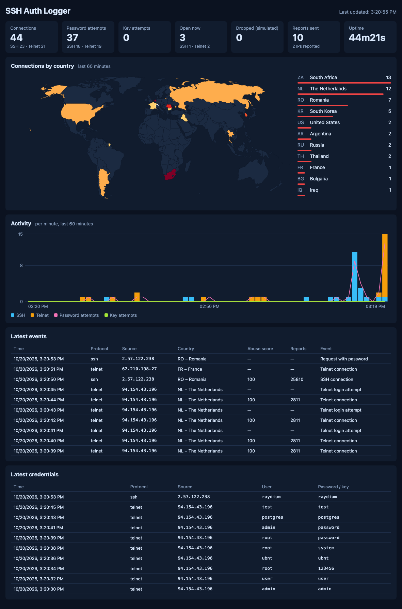

# SSH Auth Logger - WebUI

Web UI for a [ssh-auth-logger](https://github.com/GAS85/ssh-auth-logger) v2 and above.



## How to use it

1. Make sure that honeypot can write to the log file. You have to set `LOG_TO=both` or `LOG_TO=file`.
2. Make sure that log file is shared with WebUI so that it can be read.
3. Make sure that you enabled stats endpoint. You have to set e.g. `STATS_BIND=127.0.0.1:8080`.
4. On a web UI site you may set your current location with country code via `MY_LOCATION=CH`.
5. Deploy web UI near your honeypot and visit http://127.0.0.1:8081

## Docker

### Run with Docker compose

Docker compose example with variables:

```yaml
name: ssh-auth-logger

# Create isolated network
networks:
  isolated_net:
    driver: bridge

services:
  ssh-auth-logger-webui:
    image: gas85/ssh-auth-logger:latest-webui
    container_name: ssh-auth-logger-webui
    # If you would like to build from the local host
    # build:
    #   context: ./web-ui
    environment:
      # Following are default values
      # - PORT=8081                                   # Port to listen to
      - DASHBOARD_BIND=0.0.0.0                        # Listen on localhost unless told otherwise. Set it to 0.0.0.0 to enable access from container
      # - MY_LOCATION=CH                              # Your country location Alpha-2
      # - STATS_URL=http://127.0.0.1:8080/stats       # Stats URL of the Honeypot
      # - STATS_TOKEN=<token>                         # Stats Token if set
      # - LOG_FILE_PATH=/var/log/ssh-auth-logger.log  # Log file
      # - LOG_TAIL_BYTES=524288                       # Initial log file tail to start
    # Attach to the ssh-auth-logger network
    network_mode: "service:ssh-auth-logger"
    volumes:
      # Share log file, otherwise no passwords and IPs will be shown
      - ./ssh-auth-logger:/var/log
    restart: unless-stopped
    deploy:
      resources:
        limits:
          cpus: '0.50'
          memory: 512M

  ssh-auth-logger:
    image: gas85/ssh-auth-logger:latest
    container_name: ssh-auth-logger
    env_file:
      # For the Dashboard you have to set LOG_TO=both or LOG_TO=file
      - .env
    volumes:
      # Mount log file so that it can be shared with WebUI service
      - ./ssh-auth-logger:/var/log
    ports:
     - 8081:8081 # Web UI - DO NOT EXPOSE TO INTERNET
     - 2222:2222 # SSH Auth Logger
     - 2323:2323 # SSH Auth Logger Telnet
    networks:
      # Use isolated docker network, so that other containers will be not reachable from it
      - isolated_net
    restart: unless-stopped
    deploy:
      resources:
        limits:
          cpus: '0.50'
          memory: 100M
```
